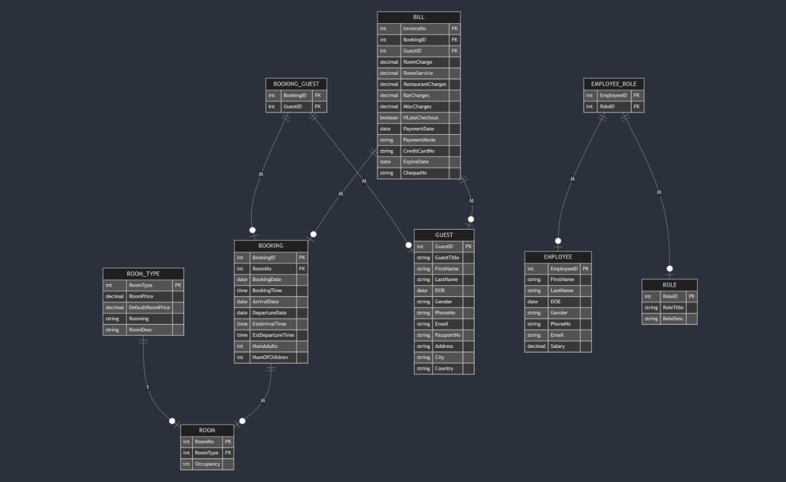

# Hotel Management System - Database Project

A course project for Database Systems - designed and implemented in Oracle SQL.

## Project Summary
This project is a relational database for a hotel. It manages rooms, bookings, guests, bills, and employees. The design uses 9 tables with proper Primary and Foreign Keys and handles Many-to-Many relationships using junction tables.

**Main Tables:**
- `ROOMTYPE` & `ROOM` - Room categories and individual rooms
- `BOOKING`, `GUEST`, `BOOKING_GUEST` - Handles bookings, including group bookings (one booking can have multiple guests)
- `BILL` - Invoices with room charges, restaurant, bar, and service charges
- `EMPLOYEE`, `ROLE`, `EMPLOYEE_ROLE` - Employees can have multiple roles

The project includes Data Dictionary, CREATE TABLE statements, 2 Views, and 5 analytical Reports (JOINs, GROUP BY, SUM/AVG) with execution screenshots. All details are in the PDF.

## ER Diagram

## Files in this Repo
- `HOTEL-ERD.jpg` - ER Diagram of the system
- `DATABASE_PROJECT.pdf` - Full report with schema, queries, views, and screenshots

## Tech Stack
Oracle SQL / SQL*Plus